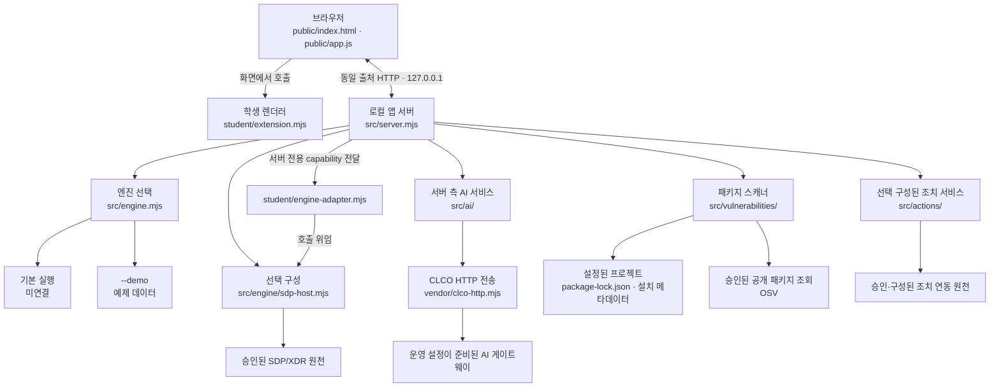

# 내 보안 Agent 시작 틀 0.2.11

이 보안 Agent는 회사 직원이 자기 로그인 상태, 업무 앱 접속 결과, 최근 접속 기록과 보안 경보를 보는 보안 앱입니다. 13단계부터 22단계까지 이 프로젝트 하나로 화면을 채워 가며 완성합니다. 주요 기능은 본인 로그인·기기 상태와 접근 판정 확인, 본인 접속 기록·보안 경보 확인, 근거에 연결된 참고용 AI 설명, 정확한 설치 패키지 버전의 OSV 취약점 조회, 조치 요청 상태와 실제 효과 관측 구분입니다. 외부 시스템 기능은 운영 설정과 권한이 별도로 준비된 경우에만 사용할 수 있습니다. 처음이라면 docs/GETTING_STARTED_STUDENT.md부터 읽습니다. 무엇을 왜 만드는지와 단계별 순서가 그 문서에 있습니다.

이 시작 틀을 받은 것만으로 단계를 통과하지 않습니다. 단계마다 docs/STUDENT_PROMPTS.md의 안내를 수업용 AI에 붙여 넣어 student/extension.mjs를 고치고, 화면에서 확인하고, 커밋한 뒤 ALEPH에 제출합니다. 제출하면 서버가 그 커밋의 코드를 받아 AI가 단계 과제 기준으로 읽고 판정합니다. 코드를 실행해서 판정하지 않습니다.

## 구성요소와 역할

| 구성요소 | 파일·경로 | 역할 |
|---|---|---|
| 브라우저 화면 | `public/index.html`, `public/style.css`, `public/app.js` | 앱 화면, 사용자 동작, 로컬 API 요청과 응답 상태를 처리합니다. |
| 학생 화면 확장 | `student/extension.mjs` | 제공 화면이 호출하는 렌더러 슬롯을 구현합니다. 화면·서버 전체를 대신하거나 서버 권한을 설정하는 파일은 아닙니다. |
| 로컬 앱 서버 | `src/server.mjs` | `127.0.0.1`에서 정적 화면과 API를 제공합니다. 계정·엔진·AI·패키지 조회 요청의 서버 측 경계를 관리합니다. |
| 접근·기록 엔진 | `src/engine.mjs`, 선택적 `src/engine/sdp-host.mjs`, `student/engine-adapter.mjs` | 기본 실행은 기존 엔진과 미연결입니다. `--demo`는 예제 데이터를 사용합니다. 운영자가 별도로 준비해 명시적으로 구성한 경우에만 SDP 호스트 경로를 사용할 수 있습니다. |
| 앱 내 AI | `src/ai/`, `vendor/clco-http.mjs` | 앱 서버가 권한을 확인한 뒤 AI 게이트웨이에 연결합니다. 브라우저가 AI 공급사에 직접 연결하거나 비밀 키를 입력하는 구조가 아닙니다. |
| 패키지 취약점 조회 | `src/vulnerabilities/` | 설정된 프로젝트의 lockfile 및 설치 메타데이터와 대조하고, 허용된 공개 패키지를 OSV에서 조회합니다. 조회 실패·미조회는 취약점 없음과 다릅니다. |
| 조치 요청 서비스 | `src/actions/` | 제공 화면이 관리하는 확인·요청·결과 조회 흐름을 서버 측에서 처리합니다. 실제 연동과 권한이 별도로 준비되지 않으면 실제 조치가 가능한 것으로 간주하지 않습니다. |

## 지원 환경 및 버전

- **실행 안내 기준 운영체제:** Windows에서 제공된 PowerShell 실행 스크립트(`tools/start-alekov.ps1`)를 사용하는 환경입니다. 다른 운영체제에서의 실행은 이 프로젝트의 안내·지원 범위로 확인하지 않았습니다.
- **Node.js:** `package.json`은 `24.19.0`을 기준 버전으로 지정합니다. 시작 스크립트는 Node.js 주 버전 22~24를 허용하고 `24.19.0`을 권장합니다. 이는 프로젝트 설정과 실행 스크립트에 기록된 범위이며, 개별 PC에 설치된 버전을 확인한 결과는 아닙니다.
- **npm 의존성:** 외부 npm 패키지 목록이 없어 일반 실행에 `npm install`은 필요하지 않습니다. PowerShell 실행 스크립트는 Node.js를 사용하며, `npm start` 등 npm 스크립트를 선택하는 경우에는 npm도 필요합니다.
- **네트워크·외부 서비스:** 기본 로컬 서버 기동과 실제 SDP/XDR, AI 게이트웨이, OSV 조회는 서로 다른 동작입니다. 외부 서비스는 해당 운영 설정과 권한이 준비된 경우에만 사용합니다.

### 버전 표기의 의미

아래 값은 서로 다른 필드의 저장소 표기이며, 서로를 대신하거나 현재 제출 커밋을 식별하지 않습니다.

- **앱 패키지 버전:** `package.json`의 `version`은 `0.2.11`입니다.
- **일반 서버 응답 메타데이터:** `src/server.mjs`의 `meta()`는 `starterVersion: '0.1.0'`을 반환합니다.
- **진단 응답 메타데이터:** `GET /api/diagnostics` 응답의 `version`도 `src/server.mjs`에서 `'0.1.0'`으로 지정되어 있습니다. 이 필드는 `starterVersion`과 이름이 다르며, 양쪽 서버 메타데이터 필드의 값이 같다고 해서 `package.json` 버전과 같은 의미가 되지는 않습니다.
- 화면이나 도움정보에서 `starterVersion` 또는 진단 `version`을 보면 해당 서버 응답 필드의 값으로 읽습니다. 앱 패키지 버전은 `package.json`에서 확인하고, 제출본의 식별에는 검토·제출한 40자리 Git 커밋을 사용합니다. 서버 응답 버전값만으로 현재 제출본, 실행 성공, 외부 연결 또는 단계 통과를 판단하지 않습니다.

## 구성도와 데이터 흐름

SDP/XDR, AI 게이트웨이, 패키지 스캔 및 조치 연동은 각기 별도의 서버 측 설정·권한이 필요한 선택 경로입니다. 구성도에 표시된 연결이 현재 PC나 계정에서 구성·승인됐다는 뜻은 아닙니다. 특히 앱을 켜거나 예제 모드를 실행한 것만으로 외부 시스템 연결, AI 설명, 취약점 조회 또는 조치 효과를 확인한 것으로 볼 수 없습니다.

## 켜기

검수 기준은 Node.js 24.19.0이며 외부 npm 의존성이 없습니다. 이 폴더의 PowerShell에서 아래를 실행하고 PC 브라우저로 http://127.0.0.1:5189 를 엽니다. 자세한 켜기·끄기·다시 켜기는 docs/STUDENT_LAUNCH_GUIDE.md에 있습니다.

    powershell -NoProfile -ExecutionPolicy Bypass -File .\tools\start-alekov.ps1

npm start도 같은 서버를 켭니다. 기본 실행은 실제 회사 시스템(기존 엔진)에 연결되지 않은 상태입니다. npm run demo는 예제 자료로 화면을 보여 줄 뿐 실제 연결이나 성취가 아닙니다. npm run check는 student/extension.mjs의 문법만 확인합니다.

## 지킬 것

- 기존 1~3차 프로젝트와 학생 파일은 지우거나 덮어쓰지 않습니다. 새 폴더에서 시작하거나, 이미 하던 프로젝트를 이어 씁니다.
- AI 열쇠·비밀번호·토큰을 코드, 커밋, 캡처, 도움정보에 넣지 않습니다. 주소나 열쇠를 직접 입력하는 칸도 만들지 않습니다.
- 비밀 설정값은 문서에 적거나 커밋하지 않습니다.

## 더 읽을 곳

- 단계별 안내와 AI에 붙여 넣을 문장: docs/STUDENT_PROMPTS.md
- 단계별 확인 항목: docs/CURRICULUM.json, docs/IMPLEMENTATION_CONTRACT.md
- 오류 코드별 해결: docs/CONNECTION_TROUBLESHOOT.md
- 시작 틀 업데이트(내 파일 보존): docs/STARTER_UPDATE.md
- 실제 회사 시스템(SDP)·앱 안 AI 연결은 담당자가 따로 안내할 때만 씁니다: docs/SDP_HOST_CONNECTION.md, docs/AI_SETUP_GUIDE.md. 이 연결은 앱을 처음 켜고 13~16단계 화면을 만들거나 공식 AI 코드 판정을 받기 위한 전제 조건은 아닙니다. 다만 17단계 이후의 실제 연결과 새 환경 재현은 해당 단계의 기준에 따라 따로 확인합니다.
