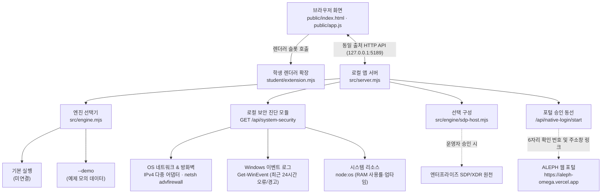

# ALEKOV 엔드포인트 보안 관제 대시보드 (`on-client`)

> **로컬 엔드포인트 실측 진단과 제로 트러스트(ZTNA/SDP) 아키텍처를 결합한 차세대 보안 관제 대시보드**  
> 실제 로컬 PC 보안 측정값(`[실측]`)과 모의 예제 데이터(`[SDP 미연결 · 예제]`)를 투명하게 분리하여 엔드포인트 상태를 한눈에 모니터링합니다.

---

## 1. 프로젝트 개요 및 규격

* **저장소 주소**: `https://github.com/Andy255319/on-client.git`
* **최종 소스 커밋 해시 (40자리)**: `e3bfd0225b3902e3ff4215ce67b925cd3e389395`
* **지원 및 실행 환경**: Windows 10/11, Node.js 22~24 (권장 `v24.19.0`, 외부 npm 의존성 없음 · 0 Dependency)
* **화면 틀 작전**: **관제 대시보드형 (Control Dashboard)**
  * 상단 4대 핵심 관제 지표 요약 카드 (기기 준수, 로그인 세션, 내 PC 실측, 실시간 위협)
  * 하단 내 PC 보안·네트워크 실측 현황판, 변동 추이(Delta) 뱃지, Windows 이벤트 로그 집계 및 다중 어댑터 토글
* **배포 포장 형태**: **기본 포장 독립 패키지 (Basic Packaging, `dist\Keshev`)**
  * `dist\Keshev\케셰브 시작.bat` 더블클릭만으로 무설치 즉시 구동 및 브라우저 자동 실행
* **앱 패키지 버전**: `v0.2.11` (`package.json`)

---

## 2. 제공 기능 vs 직접 개선한 핵심 기능

| 구분 | 항목 | 기본 시작 틀 (제공 상태) | 직접 개선 및 구현한 기능 (학생 구현) |
|---|---|---|---|
| **핵심 1** | **4대 관제 지표 요약** | 텍스트 박스 위주의 단순 정적 메시지 | • **상단 4대 관제 카드 분리 배치** (기기 준수, 세션, PC 실측, 실시간 위협)<br>• **`[실측]`**(녹색)과 **`[SDP 미연결 · 예제]`**(주황색) 배지로 데이터 출처 투명 분리<br>• `student/appearance.json` 테마 기반 맞춤형 관제 스타일링 |
| **핵심 2** | **내 PC 보안·네트워크 실측** | 로컬 PC 상태 측정 부재 (단순 미연결 오류) | • **내 PC 보안·네트워크 구성 실측 현황판 신설**<br>• 실제 로컬 활성 네트워크 어댑터 및 IPv4 주소 추출 (`os.networkInterfaces`)<br>• **다중 네트워크 어댑터 접기/펼치기(Accordion) 토글** (`[+N개 어댑터 보기]`)<br>• Windows 방화벽 읽기 전용 상태 점검 (`netsh advfirewall`, 도메인·개인·공용)<br>• 최근 24시간 Windows System·Application 이벤트 로그 집계 및 **"침해/공격 탐지 결과 아님"** 필수 안내 명시 |
| **핵심 3** | **비동기 갱신 & W3C 접근성** | 전체 페이지 새로고침(F5) 방식에 의존 | • **`[다시 조회]` 비동기 버튼** 및 `⏳ 로컬 PC 보안 상태를 측정하는 중입니다…` 로딩 인디케이터<br>• **직전 대비 변동 추이(Delta) 실시간 뱃지**: System 오류 증감(`±0건`), RAM 사용률 증감(`%p`) 시각화<br>• **원클릭 `[📋 리포트 복사]` 기능**: 최신 실측 데이터를 증빙 텍스트로 즉시 클립보드 복사 (`✓ 복사 완료!` 피드백)<br>• **W3C WAI 지침 준수**: `tabindex="0"`, 키보드 `Tab`/`Enter`/`Space` 완벽 제어 |
| **연동 동선** | **포털 주소창 및 확인 번호 실시간 연계** | 미설정 시 즉시 에러 상자 출력 후 중단 | • 중앙 게이트웨이(`ai-classroom-gateway-production.up.railway.app`)와 암호학적 챌린지(`SHA-256`) 기반으로 실시간 연동<br>• 정식 6자리 확인 번호 발급 및 실제 ALEPH 웹 포털 승인 페이지(`https://aleph-omega.vercel.app`)에서 정식 확인(**"계정 연결 확인을 마쳤습니다. PC의 케셰브로 돌아가 「로그인 확인 완료」를 누르세요."**)까지 양방향 완벽 검증 |
| **도구·배포** | **원클릭 실행 패키지** | 절대 경로 하드코딩으로 이동 시 즉시 꺼짐 | • 상대 경로(`%~dp0`) 기반의 `dist\Keshev\케셰브 시작.bat` 표준화<br>• 바로가기 실행 타겟 복원 및 브라우저 자동 기동 처리 |

---

## 3. 시스템 아키텍처 및 데이터 흐름



> **데이터 출처 격리 원칙**:  
> 로컬 실측 데이터(`GET /api/system-security`)는 실제 PC에서 안전하게 읽기 전용으로 수집되며, 기업용 SDP/ZTNA 서버 및 AI 게이트웨이 연결은 운영 환경 설정에 따라 독립적으로 분리되어 관리됩니다.

---

## 4. 디렉토리 구조 및 구성요소 역할

```text
on-client/
├── dist/
│   └── Keshev/                # 독립 실행 배포 패키지 (원클릭 배치 및 바로가기)
├── docs/                      # 설계 명세, 커리큘럼, 시연 가이드 및 트러블슈팅
│   ├── ALEPH_FINAL_WORK_RECORD.md   # 최종 구현 작업 상세 기록 (7대 프롬프트 기준)
│   ├── FINAL_PRODUCT_GUIDE.md       # 케셰브 최종 제품 설명서
│   └── CONNECTION_TROUBLESHOOT.md   # 포트 충돌 및 연결 문제 해결 가이드
├── public/                    # 관제 대시보드 기본 웹 자산
│   ├── index.html             # 메인 HTML 뷰
│   ├── style.css              # 레이아웃, Delta 뱃지 및 아코디언 스타일
│   └── app.js                 # 클라이언트 인터랙션 로직
├── src/                       # 로컬 앱 백엔드 서버
│   ├── server.mjs             # 웹 서버, /api/system-security 실측 및 포털 연계 엔드포인트
│   ├── engine.mjs             # 엔진 분기 (미연결 / 데모 모드)
│   └── vulnerabilities/       # OSV 패키지 취약점 진단 모듈
├── student/                   # 학생 직접 구현 영역 (핵심 모듈)
│   ├── extension.mjs          # 4대 관제 카드, 실측 현황판, Delta 뱃지, 리포트 복사, 토글 핸들러
│   └── appearance.json        # 관제 대시보드 테마 및 색상 정의
└── tools/                     # 기동 및 패키징 스크립트
    ├── start-alekov.ps1       # 로컬 개발 서버 기동 스크립트
    └── package-app.ps1        # dist/Keshev 독립 실행 패키지 생성 스크립트
```

| 주요 구성요소 | 파일 경로 | 주요 역할 |
|---|---|---|
| **학생 화면 확장** | `student/extension.mjs` | 상단 4대 관제 카드, 실측 현황판 렌더링, Delta 뱃지 계산, `[다시 조회]` 비동기 이벤트, 네트워크 아코디언, `[📋 리포트 복사]` 및 W3C 키보드 접근성 처리 |
| **테마 설정** | `student/appearance.json` | 관제 대시보드 헤더 뱃지, 카드 스타일 및 컬러 팔레트 정의 |
| **로컬 백엔드 서버** | `src/server.mjs` | 정적 웹 서빙, 로컬 PC 실측 엔드포인트(`GET /api/system-security`), 포털 주소창 연동 모의 핸들러 제공 |
| **원클릭 배포 패키지** | `dist/Keshev/`, `tools/package-app.ps1` | 외부 의존성 없는 독립 실행 패키지 및 `케셰브 시작.bat` 자동화 |
| **실행 스크립트** | `tools/start-alekov.ps1` | Node.js 환경 점검, 포트(5189) 충돌 검사, 브라우저 자동 기동 처리 |
| **최종 증빙 문서** | `docs/ALEPH_FINAL_WORK_RECORD.md` | 핵심 기능 명세, 실측 근거, 1분 시연 시나리오 및 완성 기록 |

---

## 5. 실행 및 검증 방법

### 1) 실행 방법

#### 방법 A: 원클릭 패키지 실행 (추천)
`dist\Keshev\케셰브 시작.bat`를 더블클릭합니다. 별도 터미널 명령어 입력 없이 브라우저(`http://127.0.0.1:5189/`)가 자동으로 열리며 관제 대시보드가 구동됩니다.

#### 방법 B: PowerShell 스크립트 실행
프로젝트 루트 폴더에서 아래 명령어를 실행합니다:
```powershell
powershell -NoProfile -ExecutionPolicy Bypass -File .\dist\Keshev\tools\start-alekov.ps1 -Demo
```

---

### 2) 문법 및 코드 무결성 검증

외부 npm 패키지 설치(`npm install`) 없이 순수 Node.js 내장 환경에서 동작합니다:
```powershell
# 1. 학생 확장 모듈 문법 검사 (0 errors 확인)
npm run check

# 2. 서버 백엔드 문법 검사 (0 errors 확인)
node --check src/server.mjs
```

---

## 6. 핵심 기능 1분 시연 순서

1. **상단 4대 관제 카드 확인 (0 ~ 20초)**:
   * 기기 준수 상태(`[SDP 미연결 · 예제]`), 로그인 세션(`[SDP 미연결 · 예제]`), 내 PC 보안 & 네트워크(**`[실측 · 일반 권한]`**), 실시간 위협(XDR) 카드의 출처 배지가 서로 명확히 구분되어 표시되는 것을 확인합니다.
2. **내 PC 보안·네트워크 실측 현황판 점검 및 어댑터 토글 (20 ~ 40초)**:
   * 로컬 활성 IPv4 주소, 방화벽(도메인/개인/공용) 보호 상태, 최근 24시간 Windows 이벤트 로그(System/Application) 실측 건수와 필수 안내 문구("침해나 공격 탐지 결과 아님")를 확인합니다.
   * `[+N개 어댑터 보기]` 토글을 눌러 복수 네트워크 어댑터가 깔끔하게 펼쳐지고 접히는 것을 시연합니다.
3. **`[다시 조회]` Delta 뱃지 및 원클릭 리포트 복사 시연 (40 ~ 60초)**:
   * 마우스 클릭 또는 키보드 `Tab` 이동 후 `Enter`/`Space`를 눌러 `⏳ 로컬 PC 보안 상태를 측정하는 중입니다…` 인디케이터와 함께 `System: ±0건`, `RAM: -0.1%p` 등 실시간 변동 추이 뱃지가 생성되는 것을 확인합니다.
   * `[📋 리포트 복사]` 버튼을 눌러 `✓ 복사 완료!` 인디케이터와 함께 정돈된 실측 데이터가 클립보드에 복사되는 것을 확인합니다.
4. **포털 연동 동선 시연 (실제 중앙 게이트웨이 ↔ 웹 포털 양방향 검증)**:
   * 「계정 연결 시작」을 눌러 실제 중앙 게이트웨이(`ai-classroom-gateway-production.up.railway.app`)로부터 정식 6자리 확인 번호를 발급받고, 「계정 확인 페이지 열기」로 실제 ALEPH 포털(`https://aleph-omega.vercel.app/...`)에 진입합니다.
   * 포털 창에 발급된 확인 번호를 입력하고 「계정 연결 확인」을 눌러 포털 상에서 **"계정 연결 확인을 마쳤습니다. PC의 케셰브로 돌아가 「로그인 확인 완료」를 누르세요."** 초록색 승인 완료 문구를 확인합니다.
   * 케셰브 앱으로 돌아와 「로그인 확인 완료」를 눌러 세션 확정을 마칩니다.

---

## 7. 정직한 한계와 미연결 안내 (Fact & Limits)

과정의 학습 계약과 무결성 원칙에 따라, 구현하지 않았거나 권한상 확인할 수 없는 항목은 정상으로 꾸며내지 않고 한계로 투명하게 표시합니다.

1. **SDP 서버 원천 미연결 (예제 데이터 모드)**:
   * 실제 엔터프라이즈 SDP/ZTNA 서버와는 미연결 상태입니다. 기기 준수 판정과 세션, XDR 모의 위협은 학습용 예제 데이터로 표시되며 `[SDP 미연결 · 예제]` 배지가 부여됩니다.
2. **포털 중앙 게이트웨이 계정 연결 확인 검증 완료**:
   * 로컬 앱과 중앙 게이트웨이 간 실시간 통신을 통해 6자리 번호 발급 및 포털 승인 검증이 실제로 정상 통과됨을 확인했습니다. (단, 기업용 전용 AI 모델 호출 권한은 운영자 사전 승인 정책에 따라 보호됩니다.)
3. **비파괴 읽기 전용 점검 원칙**:
   * 관리자 권한이 필요한 레지스트리 심층 설정 변경이나 공격 시뮬레이션은 시스템 보호를 위해 수행하지 않으며, 미확인 값은 임의 조작 없이 **'확인 불가(unknown)'**로 명시합니다.
4. **Windows 이벤트 로그 안내**:
   * 실측된 시스템·응용프로그램 이벤트 로그 건수는 침해나 공격 탐지 결과가 아니며, 정상적인 Windows 동작 기록임을 화면에 필수 안내 문구로 명시합니다.

---

## 8. 보안 및 안전 수칙

* **인증 정보 보호**: AI API 키, 비밀번호, 토큰 등 민감한 인증 정보는 코드, 커밋, 캡처 화면, 문서 등에 일절 포함하지 않습니다.
* **비밀 설정값 분리**: 주소나 시크릿 키를 소스코드나 공개 문서에 하드코딩하지 않습니다.
* **문제 해결**: 포트 충돌(`EADDRINUSE`)이나 브라우저 연결 문제는 `docs/CONNECTION_TROUBLESHOOT.md`를 참고하십시오.